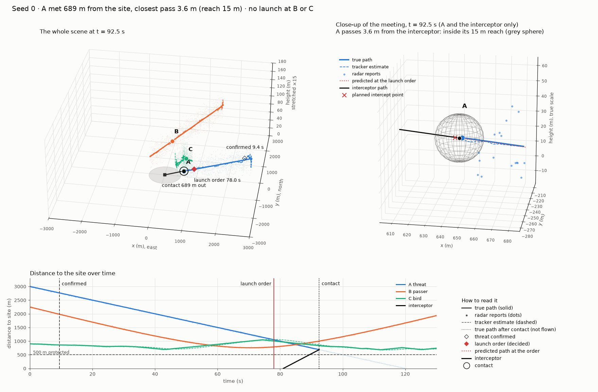

# Part 1.4 — Show it

> **PDF:** Make us see what happened: the true path, the reports, your estimate, the moment
> you decided and the intercept point.

**Run:** `.venv/bin/python -m part1_4_show_it.run --seed 0` (needs Parts 1.1–1.3 output)
**Open:** `part1_4_show_it/output/replay_seed0.html` in any browser. It is one self-contained file and works offline.
**Test:** `.venv/bin/pytest part1_4_show_it -v`

*The still picture (`replay_seed0.png`). The interactive 3D page tells the same story and adds a time slider.*

## Where each thing the PDF asks for is
| PDF asks for | How it is drawn (same colours everywhere: A blue, B orange, C green) |
|---|---|
| the true path | solid line |
| the reports | dots |
| your estimate | dashed line; on the page, an open circle shows the estimate at the slider's time |
| the moment you decided | ◇ where the threat was **confirmed** (t 9.4 s) and ◆ red where the **launch was ordered** (t 78.0 s), each at the tracker's estimated position at that moment, plus labelled vertical lines in the time panel |
| the intercept point | ✕ the **planned** intercept point (the decision output) and ○ where they **really touched** (the replay against the truth) |

## The interactive page
- **3D scene.** Everything above, plus a moving sphere for every object at the slider's time.
  The interceptor carries a see-through sphere of its **15 m reach**. "Touching" means the object
  is inside that sphere.
- **Time panel.** Distance to the site over time, with the same moments marked and a time cursor.
- **Status box** (top right). Each object's verdict from the decision step at that moment
  (e.g. "clear, passes outside 500 m", "heading in, but too slow for a drone"), plus what the
  interceptor is doing, then a small table of the **current x, y, z** (true position, in metres)
  of every object and the interceptor. **What happened** (below it) lists the timeline.
- **Views.** *Whole scene*, *Close-up* (A meets the interceptor, true scale), *Top-down* (a map).
- **Play from start** runs about 8× real time and slows to one frame per radar tick for the
  last 4 s before the meeting. The page opens on the moment of contact.
- **Legend.** One entry per layer (true path, radar reports, tracker estimate, launch plan,
  interceptor), not per object, since the colours already say which object. Click an entry to
  hide that layer for every object, for example the reports.

## Design choices
- **Only plain shapes.** Spheres, lines and dots, with no models of aircraft or munitions.
  The point is the paths and the moment two objects touch.
- **3D, plus a 2D time panel.** The 3D view shows *where*, and the distance-over-time panel shows *when*.
  Neither alone shows both the decision and the geometry.
- **Height is stretched about 10×** in the whole-scene view, because the world is 6 km wide and
  only ~120 m tall. Flat, you would not see A's shallow dive. The close-up uses true scale.
  One side effect is that the radar's 15 m height noise looks taller than it is in the stretched view.
- **The 500 m zone is a disc on the ground.** Every object flies below ~130 m, so the 500 m
  sphere and its ground circle are the same thing here. A dome with stretched height looked like
  a 1.5 km tower and misled the eye.
- **The interceptor is drawn in ink, not a 4th colour.** Palette slot 4 (yellow) is too close to
  B's orange when everything is on screen at once.
- **The camera looks across the threat's approach**, 60° off it, so A and the interceptor
  cross the screen instead of coming straight at you. A pure side view looked straight down B's
  line on seed 0.

## "Touching" is measured, not drawn from the plan
`replay.py` flies each launch order the way the PDF describes the interceptor. It stays in the
container until order + 3 s, then flies a straight line from the site **through** the aim point
at 60 m/s, and it doesn't stop at the aim point. It flies this against the **true** path and
finds the true closest pass in 0.01 s steps. Contact = closest pass ≤ `TOUCH_RADIUS_M` (15 m, an
assumption in `common/config.py`).

The generator doesn't know about the interceptor, so in `truth.csv` / `reports.csv` A keeps
flying to the site. The pictures **stop A at the contact**. The rest of its true path is a faint
dotted line ("if it had not been met"), and its reports after the contact are left out.

## Results (seed 0)
| | |
|---|---|
| threat confirmed | t 9.4 s, A estimated 2.8 km out |
| launch order | t 78.0 s, A estimated 1049 m out. The interceptor leaves at 81.0 s |
| planned | meet at t 92.4 s, **686 m** from the site |
| **what really happened** | closest pass **3.6 m** at t 92.5 s, **689 m** from the site → **contact** (reach 15 m) |
| B, C | no launch |

The aim point itself was 5.6 m from where A really was at the planned time. Most of that error lies
along the flight line: A arrives 0.05 s late, and at a closing speed of 85 m/s that is ~4.3 m. The
interceptor flies on through the aim point, which absorbs that part. What is left, **3.6 m**, is the
sideways miss. So the true closest pass can never be worse than the aim error, and the tests check
this on every seed.
While building this, seeds 0–7 all ended in contact, with closest pass 1.6–8.5 m and 684–689 m out.
Part 1.5 does the full 50 seeds.

## Known limits
- The close-up button follows the **first** launch only. Every launch is drawn in the scene.
- Contact is geometry only (closest pass ≤ 15 m). Nothing models what happens after.
- In the close-up, the bird's path crosses the box at **other times**. The moving spheres show
  where each object really is at the slider's time.
- Only seed 0's page is kept in `output/`. Any other seed: `--seed N` (after running 1.1–1.3 for it,
  or just `python run.py --seed N`).

## src/
| File | Side | What it does |
|---|---|---|
| `replay.py` | JUDGE | flies each launch order against the truth: true closest pass, contact, positions held at the contact. Part 1.5 can reuse `replay_launch()` |
| `scene3d.py` | JUDGE | the interactive page (Plotly): 3D scene, time panel, frames, views |
| `snapshot.py` | JUDGE | the still picture (matplotlib) for this README |

## tests/ (`test_show_it.py`, 13 checks)
The interceptor waits in the container, flies at 60 m/s, and is at the aim point on time ·
hand cases: a perfect plan gives a ~0 m pass, and an object 30 m off the line is a miss · 5 seeds:
one contact, at A, outside 500 m, near the planned time, closest pass ≤ aim error · pictures hold
A and the interceptor at the contact · page: one frame per slider step, in time order, opens on the
contact, close-up centred on the meeting · no launch: both pictures still draw · the page is
self-contained and the PNG is written.

## output/
| File | Contents |
|---|---|
| `replay_seedN.html` | the interactive 3D replay (≈ 7 MB, plotly.js embedded so it opens offline) |
| `replay_seedN.png` | the still picture above |
