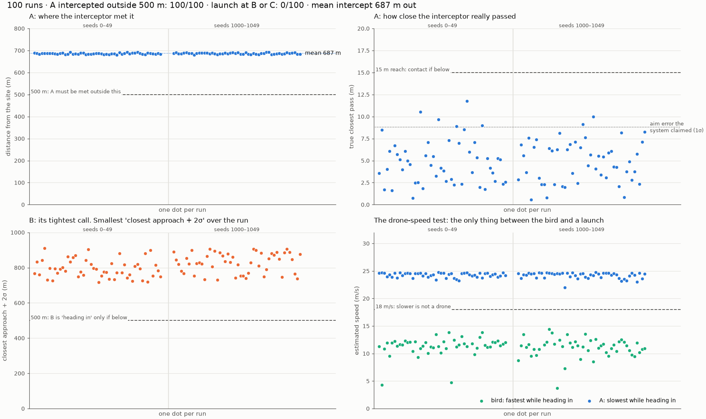

# Part 1.5 — Checks

> **PDF:** Run it over 50 random seeds. Report how often A is intercepted outside 500 m,
> how often you launch at B or C, and how far out the intercept happens on average.

**Run:** `.venv/bin/python -m part1_5_checks.run` (stands alone, ~12 s on 8 cores)
**Test:** `.venv/bin/pytest part1_5_checks -v`

## The answer
| | the PDF's 50 runs (seeds 0–49) | 50 held-out runs (seeds 1000–1049) |
|---|---|---|
| **A intercepted outside 500 m** | **50 / 50** (95% interval 93–100%) | **50 / 50** (93–100%) |
| **runs with a launch at B or C** | **0 / 50** (0–7%) | **0 / 50** (0–7%) |
| **intercept distance from the site, mean** | **687 m** (681–693, sd 2.9) | **687 m** (681–693, sd 3.0) |
| true closest pass, interceptor to A | mean 4.9 m, max 11.8 m | mean 4.9 m, max 10.0 m |

Across all 100 runs, the 95% interval puts the success rate at **≥ 96.3%** and the wrong-launch
rate at **≤ 3.7%**, in this simulated world. Full tables: [`output/summary.md`](output/summary.md).

## How a run is scored
Every seed runs the whole chain in memory: generator → tracker + decision in one real-time loop
(`decide_live`, which sees **only the radar reports**) → judge. The truth enters only at the judge.
- **"A intercepted"** = the launch order, flown against A's **true** path by Part 1.4's
  `replay.py`, really brings the interceptor within the 15 m kill radius (`KILL_RADIUS_M`, an
  assumption). The plan alone doesn't count. **"Outside 500 m"** = that meeting is more than
  500 m from the site.
- **"Launch at B or C"** = any launch order at all on B or C, whether or not it would have hit.
- **"How far out"** = distance from the site at the true moment of contact.

The tests feed the scorer runs that *should* fail: an extra launch at B, an aim point 50 m off,
and no launch at all. They check that it notices each one. A checker that can only say "50/50"
proves nothing.

## Why two blocks of 50
Seeds 0–49 are what the PDF asks for, but they are not a fair test of our own knobs. The tracker's
q was tuned on seeds 0–19, and the decision thresholds were checked on 0–49. Seeds 1000–1049
(`HELD_OUT_FIRST_SEED`) were never looked at before this check. Both blocks give the same answer,
so the thresholds are not fitted to the seeds they were chosen on.

## How close it came to failing
A clean score can hide a run that only just scraped past a threshold, so the judge also records
each guard's tightest moment (the bottom two panels):

| Guard | Must stay | Tightest over 100 runs | Margin |
|---|---|---|---|
| B: closest approach + 2σ | above 500 m | 718 m | ~220 m |
| bird: fastest estimated speed while heading in | below 18 m/s | 14.4 m/s | 3.6 m/s |
| A: slowest estimated speed while heading in | above 18 m/s | 22.0 m/s | 4.0 m/s |
| B or C: longest time holding the threat test | below 3 s | 0.0 s | never started |
| A: true closest pass | below 15 m | 11.8 m | 3.2 m |
| A: time to spare at contact | above 0 s | 7.3 s | — |

**The weak spot is the bird.** It heads at the site in 98 of 100 runs (~25 s per run), and
**only the speed test** stops it: 14.4 m/s is its worst, against 18. Part 1.3 had already found
this, and now it holds on unseen seeds too. A bird that flew 20 m/s would leave only the fit score
standing between it and a launch. That is the first constraint change I'd expect in the review.

## Why every intercept is ~687 m, wherever B and the bird are
The intercept distance is set by the launch rule, not by the scene. The decision step launches
when **5 s** (`LAUNCH_LEAD_S`) remain before the meeting would fall inside **600 m** (500 m +
`INTERCEPT_MARGIN_M`). For a target flying straight in at 25 m/s against a 60 m/s interceptor,
every second of waiting moves the meeting point 25 × 60 / 85 = **17.6 m** closer. So the meeting
lands at

    600 m + 5 s × 17.6 m/s ≈ 688 m        (measured: mean 687 m)

That is four config values, and A's own geometry is the same in every run: 3 km out, 25 m/s,
straight at the site. Only its bearing changes, and the site is the same from every side. The
3 m spread comes from the 0.1 s tick (the launch fires up to 0.1 s past the exact moment, which is
1.8 m) and from the tracker's estimate feeding the deadline.

**B and the bird can't move it, by design.** Every track is judged on its own. B and C never
start the threat clock (longest hold 0.0 s), so they never take an interceptor or touch A's
launch. Their positions *would* matter if:
- **only one interceptor were ready** and two tracks qualified (Part 2 Q3);
- **the radar didn't hand us track IDs.** Here it does (the PDF gives `track_id`), so crossing
  tracks can never swap. A real radar's can;
- **something sat near the interceptor's straight path.** Nothing here models that.

**687 m is a choice, not a limit.** Launched the moment A is confirmed (t 9.3–10.9 s, A ~2.75 km
out), the meeting would be ~1.9 km out after a 34–35 s flight, against 14 s now. The aim error
grows with flight time (Part 1.3), so we wait. Change `LAUNCH_LEAD_S` or `INTERCEPT_MARGIN_M` and
the 687 m moves with it. Part 2 Q1 is about that trade.

## What 100 / 100 does *not* tell you
- **Every run is the same engagement.** Only A's bearing, the noise, the dropped reports, B's line
  and the bird's wandering change. The runs test robustness to noise, not to different threat
  behaviour (a slower or faster A, one that weaves, one that starts closer).
- **Not exercised here:** a radar outage (Part 2 Q2), two threats at once (Q3), a manoeuvring
  threat, a faster bird, a second shot after a miss.
- The intervals describe **this simulator**. They say nothing about a real radar until the noise
  and drop models are measured (Part 2 Q5).

## Changing a constraint
Every number is in `common/config.py`. Edit it and run `python -m part1_5_checks.run` again to get
both 50-run blocks back in ~12 s. The worker processes re-read the file, so edit it rather than
patching values in memory.

## src/
| File | Side | What it does |
|---|---|---|
| `evaluate.py` | JUDGE | scores one run: replays every launch against the truth (via `part1_4_show_it/src/replay.py`), right or wrong target, margins of each guard |
| `montecarlo.py` | both | runs seeds in parallel (system on reports only, judge on truth), summary numbers, 95% Wilson intervals, the Markdown tables |
| `plot_checks.py` | JUDGE | the picture above: one dot per run in four panels, each against the line it must stay clear of |

## tests/ (`test_checks.py`, 10 checks)
A clean run scores as success · an extra launch at B counts as wrong · an aim point 50 m off counts
as no contact · no launch counts as a failure · margins match a hand computation · Wilson interval
at 0/n and n/n · summary counts on a hand-built table · parallel = one by one · 10 unseen seeds
(2000–2009) meet A outside 500 m with no wrong launch · summary, picture and CSV are written.

## output/
| File | Contents |
|---|---|
| `summary.md` | the result tables for both blocks (written by the run, not by hand) |
| `checks.png` | the picture above |
| `results_seeds0-49.csv`, `results_seeds1000-1049.csv` | one scored row per run (format: `RUN_RESULT_DTYPE` in `common/files.py`) |
